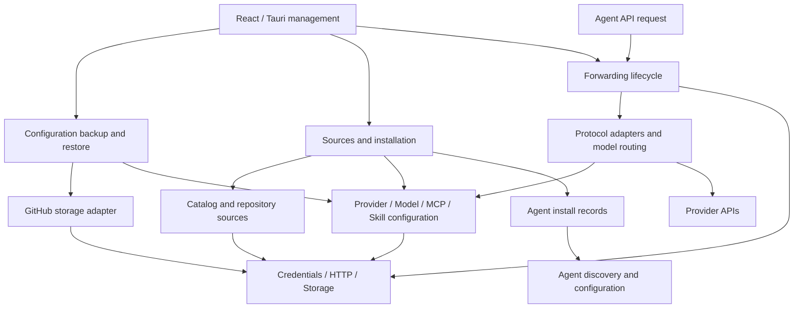

# Backend module boundaries

This page keeps the current Rust structure and the constraints for future
integrations. BR0–BR5 are complete. Task status lives only in
[`todo.md`](todo.md) under the BR series.

## Current structure

Keep one Rust crate using `feature.rs` plus a matching `feature/` directory. Never
create `mod.rs`. Module functions stay private or `pub(super)`; open an item as
`pub(crate)` only for a real cross-feature need. Command names, serde fields,
error codes, stable IDs, credential service names and published migrations are
compatibility contracts.

| Boundary                       | Responsibility                                                       | Constraint                                                             |
| ------------------------------ | -------------------------------------------------------------------- | ---------------------------------------------------------------------- |
| `commands`                     | IPC arguments, Tauri state, blocking/async scheduling, safe errors   | Business modules never depend back on commands or Tauri                |
| `providers`                    | Provider instances, protocol choice, templates, instance credentials | Does not hold GitHub/Vercel cloud accounts                             |
| `models`                       | Saved models, selection, capability metadata, aliases, search        | Links by `ProviderId`; does not borrow fetch SQL helpers               |
| `model_fetch`                  | Discovery, cancellation lifecycle, snapshots, cache, merge           | Network outside the database lock; merge rechecks the revision         |
| `model_catalog`                | Vendor response parsing, catalog paging, verified capability mapping | Adapt per vendor; the same protocol does not imply the same model API  |
| `model_http`, `model_identity` | Model-list HTTPS GET; model-ID grammar and protocol routes           | Not a general streaming or cloud-service client                        |
| `mcp`                          | Central stdio/HTTP definitions, credentials, central state           | Saving and showing never start a server                                |
| `skills`                       | Central library, import, source editing, deletion                    | Install, update and deployment are separate use cases                  |
| `agents`                       | Discovery, version evidence, write adapters, history IPC             | Adapter mapping is independent of Provider protocols                   |
| `config_plan`, `config_apply`  | Target digests, plans, backups, journal, history, restore            | See [`configuration.md`](../configuration.md)                          |
| `storage`                      | Database lifecycle and the single ordered migration entry            | Each feature owns its SQL; no central CRUD layer                       |
| `credentials`                  | Non-leaking secret type, OS store interface and implementation       | Platform layer does not know Provider/MCP/cloud types                  |
| `shared`                       | Time and text/ID format checks used more than once                   | Stays small and specific                                               |
| `integrations` (future)        | GitHub/Vercel accounts and resource operations                       | Cloud contracts stay separate; share infrastructure only on real reuse |

SQL lives in each feature's repository; credential compensation and operation
coordination live in its service. Commands only validate IPC input and schedule
work. Model fetch takes its snapshot, releases the database lock, then reads the
credential, and the merge rechecks the revision. Cancellation, browse cache, raw
API offsets and result offsets stay distinct.

`http_client` is not a module yet: the model-list client returns a complete body
and cannot serve streaming forwarding. Extract a shared transport only when a
second real use requires it, and keep authentication, business error codes and
retry in each service.

## Adding a vendor

Verify brand, protocol, authentication, model discovery and capability/parameter
fields separately. An existing Chat Completions route does not prove a new vendor
works. Keep an explicit brand enum and capability declaration, add the response
adapter, and introduce a small static adapter interface only when several vendors
genuinely share behavior. Do not require every vendor to implement discovery,
inference, quotas and OAuth behind one trait. A database CHECK or validation that
restricts brands needs a migration that preserves existing instances and models.

## Future integrations

These are recorded intentions. None is scheduled or implemented; the interface
must not suggest otherwise. Task cards are BR6–BR11 in [`todo.md`](todo.md).

### Cloud service accounts

GitHub is the confirmed backup target; Vercel's purpose is undecided and deferred
(2026-10-13). A cloud connection has its own account/connection ID, authorization
state and resource types; it never reuses `ProviderId`, `ProviderKind` or the
provider instance table.

- Share the OS credential layer. Credential reference prefixes and service names
  are a storage compatibility contract. OAuth token and refresh-token lifecycles
  differ from API keys; define account state, scopes, expiry/refresh/revocation and
  the system-browser callback when the first authorization is designed.
- A GitHub repository API, a Skill source and a GitHub MCP server are different
  uses. They may reference one explicitly chosen account, but one use's grant does
  not imply the others.
- Vercel and GitHub MCP servers stay central MCP definitions and may map to an
  integration account explicitly. An ordinary HTTP MCP URL does not become a cloud
  account or enable OAuth.
- Preserve paging, permission/resource errors and rate-limit information. The
  current model-discovery classification (403 means auth failure, 402 means no
  balance) must not be inherited.

### Configuration backup to GitHub

A `backup` module owns the versioned format, snapshots and restore rules;
`integrations/github` owns remote file access, authentication and remote revision
information. A different target later must not rewrite the backup rules. Explicit
backup/restore comes before any automatic sync because the conflict semantics
differ.

Export a controlled format containing configuration, model selections, MCP/Skill
definitions and their pinned source versions — not a live SQLite file, logs or a
whole Agent config directory. Exclude OS credential values by default; a credential
reference from another machine is not a usable authorization. Restore states which
credentials must be re-associated. Migrating credential values would need a
separate encrypted format and key-recovery plan.

One snapshot stays internally consistent; a remote update carries revision and
conflict checks, touches only the managed backup path in a chosen repository, and
never overwrites other files. Restore validates the version before showing
differences, resolving identity conflicts and writing. Restoring local definitions
does not install MCP/Skill packages, execute commands, start a gateway or write
Agent configuration.

### Source-based installation

`sources` turns catalog APIs and Git repositories into inspectable candidates:
source identity, version/revision, resource type, download location and dependency
declarations. Verify each source contract when it is integrated; do not assume every
"provider" shares one install protocol.

`installation` coordinates candidate choice, version pinning, preview, install,
update, uninstall and failure recovery. An MCP install yields a usable local
package/executable path plus a central definition; a Skill install yields managed
files and a source record. Installers are an explicit allowlist with structured
executable and arguments, never a script API. Showing a catalog, importing a
definition, restoring a backup or reading metadata never runs an install command.

MCP dependency install, server start/connection and Agent deployment have separate
states, as do Skill local install and Agent link/copy deployment. An update keeps
user modification information and records managed paths, pinned revision, steps and
results for retry/uninstall; user-unowned files are never deleted. The safe file
writer and operation recovery can be reused, while GitHub backup, software install
and Agent configuration backup keep their own formats.

### Direct Agent installation

`installation` owns Agent install/upgrade/uninstall; `agents` keeps discovery,
version/capability detection, precedence and configuration application. Each Agent's
package manager or release archive is implemented as its own adapter after its
official contract is verified, sharing downloads, version pinning, managed-install
records and progress instead of forcing one command shape.

The flow is: choose Agent → inspect the existing install and target platform/arch →
show the install plan → execute → detect the actual version and capabilities.
Upgrade and uninstall follow the managed-install record. An existing user install
is identified by source first; "discovered" does not mean "installed by vibemate and
safe to delete". Agent configuration and user working directories are outside
package cleanup. A version upgrade can change configuration capability, so detect
first and then build the configuration diff.

Finishing an install only means the software exists. It does not start the Agent,
configure a model or claim a working inference connection.

### Local API forwarding

A `gateway` service runs inside Rust and owns local listening, start/stop,
connection handling, routing snapshots and runtime status. React manages it over
Tauri; Agents call the local API directly, so forwarded traffic never goes through
Tauri IPC. Agent configuration that points at the local endpoint is still written by
`agents`. Start with explicit local-only access and authorization; external
listening, cloud deployment and multi-user service are separate.

`protocols` converts verified request/response and streaming events; the Provider
adapter owns upstream authentication, endpoints and vendor differences. The gateway
routes by stable Provider/Model identity rather than display alias. MCP server
routing and LLM API forwarding are different contracts and do not share a business
interface just because both use HTTP.

Prove a same-protocol forwarding path first, then add conversions one at a time. The
matrix must cover normal and streaming responses, tool calls, errors, client
cancellation and upstream cancellation; reasoning, image and parameter conversions
need the real protocol. Unsupported mappings are refused explicitly. Rate-limit
retries and route switching must account for already-emitted output and duplicate
requests; the model-list GET behavior does not transfer. TLS/proxy/timeout basics
can be shared, but a client returning a complete `Vec<u8>` cannot implement
streaming forwarding. Runtime needs snapshot reads and short credential access and
must not hold SQLite locks across long connections.

### Dependency sketch

All nodes below are future design; none exists today.

## Refactoring rules

A migration batch usually touches 1–5 real files and can be reverted on its own.
One batch does not change IPC, data format, concurrency rules and directory
structure together. Pure moves add no duplicate tests but must run the existing
suite; real gaps get targeted tests.

Acceptance: existing command names, serde fields/error codes, stable IDs,
credential service names and published migrations stay intact unless a task
changes them explicitly. Credential prompts stay outside the SQLite lock; model
fetch snapshot and merge revision checks, cancellation stages and resource release
order stay unchanged. Stored selections, non-secret MCP metadata, credential
cleanup, compensation and unknown-outcome reloads stay covered. Normal behavior
and tests still run without a Tauri window. Run Rust fmt, locked Clippy (all
targets, zero warnings) and the full test suite; batches that move commands,
exports or build resources also run the frontend check, the locked desktop build and
an isolated native IPC check where affected. Real credential stores and other
platforms stay open until actually verified.
